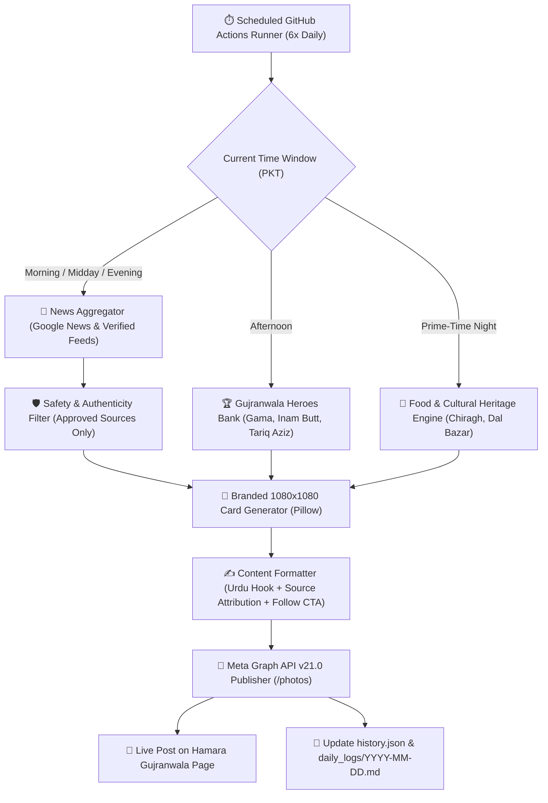

# 🇵🇰 Hamara Gujranwala — Facebook Autonomous Growth Engine

[](https://www.facebook.com/profile.php?id=61578710350501)
[](https://python.org)
[](https://github.com/zubairiteng/gujranwala-page/actions)
[-success?style=for-the-badge)](#)

An autonomous, 24/7 news, culture, and growth manager for the **Hamara Gujranwala** Facebook Page (`Page ID: 61578710350501`). Designed to deliver verified breaking news, tribute features to Gujranwala's heroes and wrestling legends, cultural highlights, and reach **2,000+ organic followers in 30 days**.

Runs entirely in the cloud via **GitHub Actions** — zero local disk space required.

---

## 🎯 Target & Strategic Pillars

- **Facebook Page:** [Hamara Gujranwala (ہمContent: ہمارا گوجرانوالہ)](https://www.facebook.com/profile.php?id=61578710350501)
- **Tagline:** *"گوجرانوالہ کی ہر گلی، ہر چوک، اور ہر تندور کی خبر اب آپ تک"*
- **30-Day Growth Target:** **2,000+ Real Followers**
- **Daily Post Cadence:** **6 to 10 High-Engagement Posts Daily**
- **Strict Verification:** 100% Authentic sources (Dawn, The Express Tribune, Geo, Dunya, ARY, BBC Urdu, APP). **Zero fake news, zero unverified rumors, zero cybercrime.**

---

## 🏗️ System Architecture



---

## 📅 Daily Posting Schedule (Pakistan Standard Time — UTC+5)

| Slot | PKT Time | UTC (Cron) | Theme | Format |
|------|----------|------------|-------|--------|
| **1** | **08:30 AM** | `30 3 * * *` | Morning Briefing & Weather / Traffic | Branded News Card + Urdu Summary |
| **2** | **11:30 AM** | `30 6 * * *` | Breaking / Real-time City News | News Card + Verified Source Citation |
| **3** | **03:00 PM** | `00 10 * * *` | Hero & Wrestling Legend Tribute | Golden Hero Card + Inspiring Story |
| **4** | **06:30 PM** | `30 13 * * *` | Evening Local Developments & Alerts | Civic / News Card + Discussion Hook |
| **5** | **08:45 PM** | `45 15 * * *` | Gujranwala Food, Industry & Culture | Cultural Card + Foodies Poll |
| **6** | **10:30 PM** | `30 17 * * *` | Late-Night Community Question | Discussion Card + Follower CTA |

---

## 🌟 The Gujranwala Heroes & Heritage Bank

The engine includes pre-curated, highly engaging profiles of Gujranwala icons:
1. **The Great Gama (Ghulam Mohammad Baksh)** — Undefeated World Champion Wrestler (*Rustam-e-Jahan*).
2. **Muhammad Inam Butt** — 2x Commonwealth Games & World Beach Wrestling Gold Medalist.
3. **Bholu Pehlwan** — First official *Rustam-e-Pakistan* and recipient of Pride of Performance.
4. **Tariq Aziz** — Founder of *Neelam Ghar* and PTV legend with Gujranwala roots.
5. **Amrita Pritam** — World-famous Punjabi literary icon born in Gujranwala in 1919.
6. **Famous Food Delicacies** — Chiragh Tikka, Pehlwan Lassi, Dal Bazar fried fish, batair, Halwa Puri.
7. **Manufacturing Powerhouse** — Electric fans, cutlery, sanitary ware, crockery, and agriculture.
8. **Iconic Landmarks** — Nishan-e-Manzil (GT Road), Sheranwala Bagh, Historic Railway Station.

---

## 🛡️ Editorial Rules & Safety Guardrails

- **Mandatory Source Attribution:** Every news report explicitly cites its official origin:
  `📌 باضابطہ اور تصدیق شدہ ذریعہ: Dawn News (ڈان نیوز)`
- **Zero Hurt / Zero Defamation:** No hurtful remarks, no personal slander, no unverified social gossip.
- **Strict Legal Compliance:** Compliant with PECA laws, Facebook Community Standards, and Pakistani cyber ethics.
- **High-Converting Formatting:** Every post ends with an inviting call to action to follow the page:
  `👉 گوجرانوالہ کی ہر بریکنگ نیوز اور باوثوق معلومات کے لیے ہمارے پیج 'Hamara Gujranwala' کو فالو کریں!`

---

## 🚀 Quick Setup (Zero Local Space Required)

You do **not** need to run anything on your computer. Setup is done in 2 minutes:

1. Follow the **[🔑 Step-by-Step Facebook Token Setup Guide](SETUP_GUIDE.md)** to generate your Page Access Token.
2. In this GitHub repository, go to **Settings > Secrets and variables > Actions**.
3. Add the secret:
   - `FB_PAGE_ACCESS_TOKEN` = `your_page_access_token`
   - `FB_PAGE_ID` = `61578710350501`
4. Go to the **Actions** tab and click **Run workflow**! The bot will automatically publish 6–10 posts every single day.

---

## 📊 File Structure

```
gujranwala-page/
├── .github/workflows/
│   └── facebook_automation.yml  # Cloud scheduler (6x daily)
├── daily_logs/                  # Daily audit logs of published posts & stats
├── 30_DAY_GROWTH_PLAYBOOK.md    # Organic strategy to gain 2,000+ followers
├── SETUP_GUIDE.md               # Guide to configure Meta Page Access Token
├── config.py                    # Configuration, source whitelist, posting slots
├── news_aggregator.py           # Real-time verified Gujranwala news fetcher
├── heroes_bank.py               # Database of Gujranwala legends, food & heritage
├── card_generator.py            # Automated 1080x1080 Pillow visual card creator
├── content_formatter.py         # Bilingual high-converting caption writer
├── fb_poster.py                 # Facebook Graph API v21.0 client
├── daily_engine.py              # Main autonomous orchestrator
├── history.json                 # Deduplication database to prevent repeats
└── requirements.txt             # Lightweight Python dependencies
```
